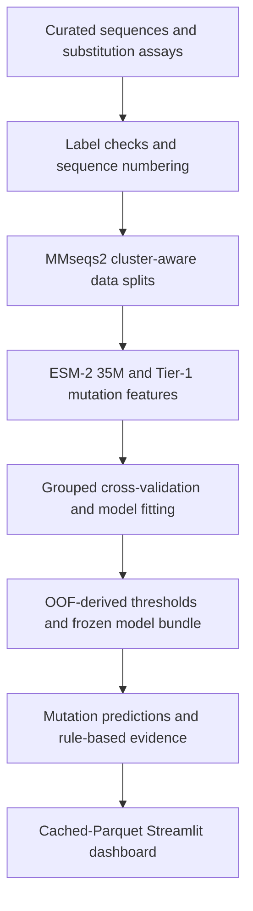

# Xynapse-AI-

<!-- XYNAPSE-ML:BEGIN -->
## Xynapse AI | single-substitution effect predictions

> **Predictions are computational hypotheses, not experimental findings.**

Xynapse AI estimates two mutation-level quantities for a single amino-acid substitution in a protein sequence:

1. **Stability:** `ddg_pred`, a regression estimate in kcal/mol. The project convention is **positive = predicted destabilization** and negative = predicted stabilization.
2. **Function impact:** `p_impact`, the calibrated model probability for the project’s DMS-derived *damaging* class. It is not a clinical pathogenicity probability and must be interpreted with the assay-direction caveat below.

The system also assigns a rule-based rank class and, when source annotations are available, evidence-linked mechanism hints. These outputs are computational prioritization aids—not experimental measurements, diagnoses, or causal conclusions.

### Release snapshot

- **Sequence model:** `facebook/esm2_t12_35M_UR50D` (`esm2_t12_35M`). This project release uses the 35M model; it does not run the 650M model.
- **Available model tier:** Tier 1. No Tier-2 model is available because sufficiently complete, sequence-matched annotation tables were not available for the required training cohort.
- **Case-study/demo bundle:** PTEN (`P60484`) and TP53 (`P04637`), with 15,124 substitutions in total. The tracked dashboard bundle is explicitly marked **`DEMO - NOT REAL`**; it is not a substitute for model weights or a full prediction run. Sources: [`reports/tables/phase_09_prediction_summary.json`](reports/tables/phase_09_prediction_summary.json), [`demo_data/manifest.json`](demo_data/manifest.json).
- **Training cohort:** stability: 52 proteins / 45,411 rows; function: 26 proteins / 71,962 rows. The longest stability training sequence is 72 aa; the longest function training sequence is 465 aa. Sources: [`models/esm2_t12_35M/stability_tier1.json`](models/esm2_t12_35M/stability_tier1.json), [`models/esm2_t12_35M/function_tier1.json`](models/esm2_t12_35M/function_tier1.json).

## Scientific and computational workflow



**Mutation keys and positions.** A mutation row is keyed by `(protein_id, position, wt, mut)`. Positions are 1-based. Only single substitutions are modeled; each canonical residue has 19 alternative amino acids. Protein-level outputs therefore contain `19 × sequence_length` rows when the sequence is canonical and the prediction table is complete.

**Stability labels.** The source stability convention assigns positive ΔΔG to stabilizing substitutions. The project converts it to the declared project direction using `ddg_project = deltaG_wt - deltaG_mut`, so positive project ddG means destabilizing. Reliable observations use the documented confidence-interval and dynamic-range filters; the domain WT reference is the median of reliable WT rows. Exact source quotes, parsing, numbering and reliability evidence are in [`docs/data_cards/megascale.md`](docs/data_cards/megascale.md) and [`docs/label_definitions.md`](docs/label_definitions.md).

**Function labels—and a material caveat.** Function targets come from ProteinGym DMS assay binary labels. Raw assay scores are kept assay-specific; one assay is selected per target sequence, and ClinVar labels are reserved for external evaluation rather than model training. The ESM direction pre-check covered five assays; the assay correlations had mixed signs (three positive, two negative; pooled mean Spearman `+0.12184444578563125`). The owner authorized using the pooled orientation provisionally: source binary label 1 is mapped to project damaging label 0, and source 0 to project damaging label 1. **The direction is unresolved at the individual-assay level.** Consequently, `p_impact` is a model probability for this provisional pooled target—not a universal measure of protein function or clinical risk. Evidence and the explicit decision are documented in [`docs/data_cards/proteingym.md`](docs/data_cards/proteingym.md), [`reports/tables/proteingym_direction_precheck.csv`](reports/tables/proteingym_direction_precheck.csv), and [`docs/label_definitions.md`](docs/label_definitions.md).

**Leakage control and evaluation.** Proteins are grouped by MMseqs2 sequence clusters (identity 0.30, coverage 0.80); related case-study and external-test clusters are excluded from model training. Model selection and reported out-of-fold (OOF) estimates use grouped folds. The held-out cluster and ClinVar evaluations were each recorded once after the freeze; they were not used to retune the models. Split evidence is in [`docs/data_cards/splits.md`](docs/data_cards/splits.md); all saved results and caveats are collected in the [final report](reports/FINAL_REPORT.md).

## Features and models

Both models use the same frozen Tier-1 feature inventory: ESM-2 mutation likelihood-ratio and wild-type/mutant log-probability features; BLOSUM62; hydropathy, volume and charge deltas; per-position mean/minimum ESM LLR; relative sequence position; and categorical wild-type and mutant amino acids. The saved model metadata lists the exact feature order and category handling.

- **Stability:** LightGBM regression, trained on the reliability-filtered single-substitution labels. Grouped OOF results for the selected Tier-1 model: Spearman `0.480236`, Pearson `0.545774`, RMSE `0.823110` kcal/mol (52 proteins). The one-time held-out cluster result: Spearman `0.452339`, Pearson `0.557175`, RMSE `0.858766` kcal/mol (8 proteins; 7,390 rows).
- **Function:** LightGBM binary classification with isotonic calibration selected by grouped cross-fitted Brier score. Grouped calibrated OOF results: AUROC `0.642153`, AUPRC `0.599067`, MCC `0.276048` (26 proteins). The one-time held-out cluster result: AUROC `0.757075`, AUPRC `0.654022`, MCC `0.379725` (4 proteins; 4,815 rows).
- **External ClinVar set:** 646 variants across PTEN and TP53; the saved one-time result is AUROC `0.869244`, AUPRC `0.947390`, MCC `0.335855`. This set is narrow in gene coverage and class balance; it does not resolve the DMS label-direction caveat.

These metrics describe the specific saved partitions and labels above. They should not be generalized to unrepresented proteins, assay phenotypes, or clinical use. Per-assay results and comparison baselines are in [`reports/tables/phase_08_test_evaluation_summary.json`](reports/tables/phase_08_test_evaluation_summary.json); model cards: [`stability`](docs/model_cards/stability_tier1.md) and [`function`](docs/model_cards/function_tier1.md).

## Ranking and evidence semantics

Frozen OOF-derived thresholds are recorded in [`configs/config.yaml`](configs/config.yaml) and [`reports/tables/threshold_evidence.csv`](reports/tables/threshold_evidence.csv). The damaging ddG cutoff is `0.6763490078708566` kcal/mol; the high-impact probability cutoff is `0.5874781534295241`. `p_impact_low` is null because no OOF cutoff met the configured negative-predictive-value target. As a result, this release cannot assign the **tolerated** or **potentially beneficial (hypothesis)** classes; applicable rows are ranked **potentially damaging** or **uncertain**. “Potentially beneficial” is, by definition, only a hypothesis of predicted stabilization with function preservation.

Mechanism flags are deterministic rules applied only when the relevant annotation columns exist—for example, an annotated catalytic/binding site at high predicted impact, or a buried destabilizing substitution when relative solvent accessibility is available. Missing annotations do not establish that a mechanism is absent. `evidence_text` uses fixed templates populated from row values; it does not use an LLM or generate free-form biological explanations. Review [`docs/limitations.md`](docs/limitations.md) before interpreting any mechanism hint.

## Run the dashboard

Python 3.12 is the documented runtime. From the repository root:

```sh
python3.12 -m venv .venv
source .venv/bin/activate
python -m pip install -r requirements.txt
streamlit run app/app.py
```

The app reads cached Parquet only: it prefers `data/processed/predictions.parquet` and falls back to `demo_data/predictions.parquet`. The fallback is visibly labelled **`DEMO - NOT REAL`**. To select another prediction directory, set `XYNAPSE_DATA_DIR` to a directory containing `predictions.parquet` before launching Streamlit. Dashboard setup and optional deployment steps are in [`docs/DEPLOY.md`](docs/DEPLOY.md).

The interface provides a protein summary, substitution heatmap (`ddg_pred`, `p_impact`, or `esm_llr`), filterable mutation table and CSV export, mechanism evidence, limitations, and an optional structure view. The structure view is display-only: it may retrieve an AlphaFold structure from the documented host and colors its per-residue display field with a prediction-derived value; this is not experimental structural evidence.

## Run inference (requires the matching model package)

The source repository intentionally excludes model binaries and large raw/processed research tables. To run inference, first obtain the model artifacts through the owner-managed distribution process in [`docs/SHARING_ARTIFACTS.md`](docs/SHARING_ARTIFACTS.md), and verify them against the matching `FROZEN.json`. Then, from the repository root:

```sh
PYTHONPATH=src python -m xynapse.pipeline \
  --uniprot P60484 \
  --esm-model dev \
  --out /path/to/prediction-output
```

The pipeline uses a cached verified sequence when available or retrieves a UniProt FASTA record, scores all single substitutions with the configured ESM-2 35M model, builds Tier-1 features, applies the frozen model bundle and thresholds, and writes `predictions.parquet`, `features_tier1.parquet`, and `pipeline_summary.json` under the selected output directory. It refuses a missing or hash-mismatched frozen artifact. Replace `P60484` with a verified UniProt accession; do not infer accession mappings from names alone.

## Reproduce and inspect project artifacts

```sh
python -m pytest -q
python scripts/validate_tables.py
python scripts/leakage_audit.py
python scripts/claims_audit.py
python scripts/make_reports.py
```

`make_reports.py` rebuilds derived reports/model cards from saved local outputs. It does not reacquire raw sources or rerun the frozen one-time evaluations. The full final verification command is `python scripts/verify_all.py --repo ../xynapse-shared` when using the documented sibling shared-clone layout; it includes tests, table checks, audits, frozen-hash checks, pipeline reproduction, dashboard tests, staged-file checks and a clean-clone test.

## Data, model artifacts and reproducibility

Dataset acquisition, exact source URLs, retrieval dates, checksums, inspected columns, filters and unresolved items are recorded in [`docs/data_cards/`](docs/data_cards/). The label definitions and sign conventions are described in [`docs/label_definitions.md`](docs/label_definitions.md). Raw datasets, complete processed tables, OOF files and model binaries are local/owner-managed artifacts and are not committed to this Git repository. The tracked demo bundle contains only dashboard example predictions and small display structures; it does not contain model weights. See [`docs/SHARING_ARTIFACTS.md`](docs/SHARING_ARTIFACTS.md) for controlled artifact sharing and [`reports/FINAL_REPORT.md`](reports/FINAL_REPORT.md) for the release inventory, recorded metrics, thresholds and caveats.

## Important limitations

- The function-label direction is provisional because assay-level signs disagreed in the pre-check. Function scores require assay-aware interpretation.
- Stability training sequences are short (maximum 72 aa); ddG predictions for longer proteins are extrapolations and receive low ddG confidence under the project rule.
- The current outputs cover two case-study proteins. They are not a broad protein panel; ClinVar evaluation also covers only PTEN and TP53.
- No Tier-2 model exists. Current predictions are Tier 1; teammate annotations are incomplete, PTEN evolutionary data are low-diversity, and `msa_logodds` is unavailable.
- The frozen low-impact threshold is null, so tolerated and beneficial-hypothesis assignments are disabled in this release.
- ESM-2 pre-training may include sequences related to proteins used here. Labels are split by sequence cluster, but pre-training exposure is not excluded.
- AlphaFold views and annotation-derived mechanism flags are computational/display context, not experimental evidence. Missing annotation is not evidence of biological absence.

For full detail, see [`docs/limitations.md`](docs/limitations.md), [`docs/label_definitions.md`](docs/label_definitions.md), the two model cards, and the per-dataset cards. Release branch and immutable tags are recorded in [`reports/release.json`](reports/release.json).

**Predictions are computational hypotheses, not experimental findings.**
<!-- XYNAPSE-ML:END -->
